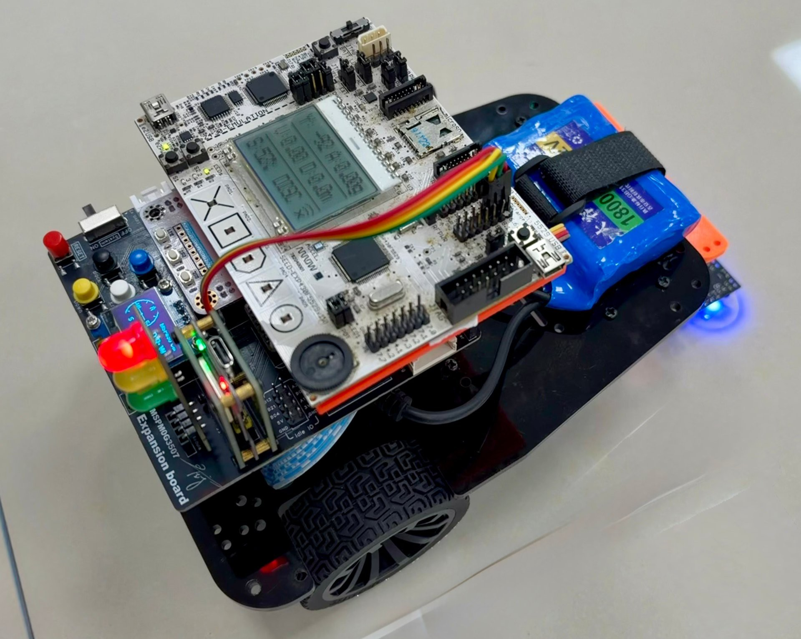
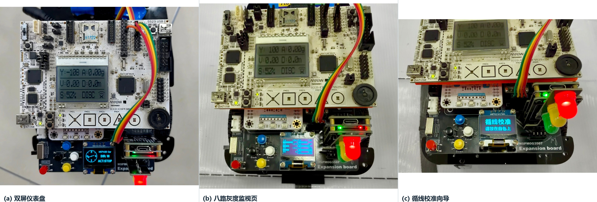
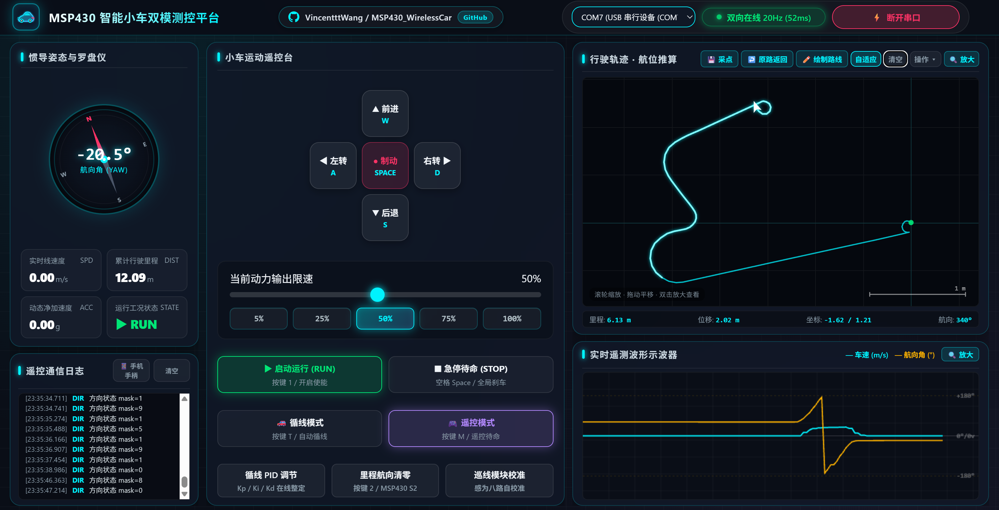
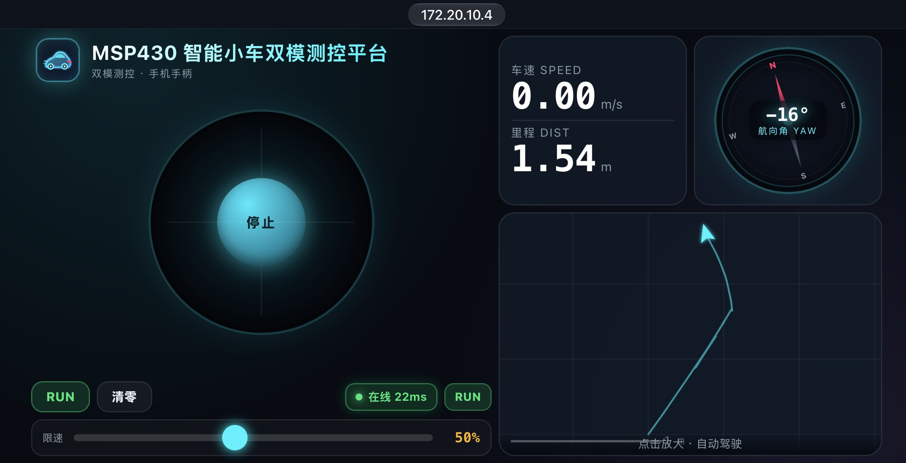
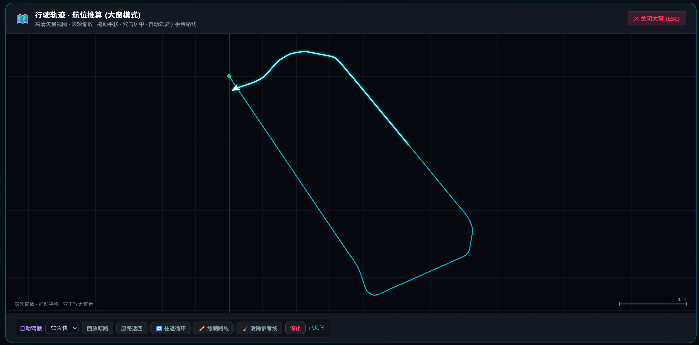

# MSP430 无线智能遥测小车

[](LICENSE)
[](https://github.com/VincentttWang/MSP430_WirelessCar)
[](https://www.ti.com/)

以 **MSP430F5529 为唯一决策主控**、天猛星 MSPM0G3507 作为底层接口桥的无线智能小车：
三端同步遥测、惯导航位推算建图、八路灰度循线闭环与自主返航，配一套免安装的 Web 测控工作站。

> 📄 课程设计报告（终稿，20 页）：[`docs/MSP430无线智能遥测小车设计报告_U202413712_王佳宁.pdf`](docs/MSP430无线智能遥测小车设计报告_U202413712_王佳宁.pdf)
> 📦 提交附件（含报告、核心代码与示例图片）：`MSP430设计报告附件_U202413712_王佳宁.rar`

[核心特性](#-核心特性) · [界面预览](#-界面预览) · [系统架构](#-系统架构) · [硬件与引脚](#-硬件连线与引脚定义) · [通信协议](#-通信协议) · [快速开始](#-快速开始) · [文档索引](#-文档索引)

---

## 🚀 核心特性

- **主控 + 接口桥分工**：MSP430F5529 承担全部决策与交互（按键/旋钮、DOGS102x6 液晶、协议解析、状态机、航位推算、导航决策、分级失效保护）；天猛星 MSPM0G3507 只做电气时序翻译与原始量回送（PWM、编码器、I2C、OLED、遥测组包），不参与判断。两块 ESP32 成对透明传输，PC 侧表现为标准 COM 口（115200 8N1）。
- **三端同步遥测**：电脑网页、手机网页、车载 DOGS102 液晶与 OLED 显示同一帧 20 Hz 数据（车速、里程、航向、净加速度、左右轮占空比）。
- **Web 测控站**：`index.html` 支持 Web Serial 原生直连；`web_server.py` 提供 HTTP 桥接供手机端走同源 `/api/*`。含 360° 罗盘、双通道示波器、航位推算轨迹地图、CSV/PNG 导出，以及 IPv4/IPv6 双栈与手机热点网段自动识别。
- **五种自主导航玩法**：采集轨迹、回放原路、原路返回、往返循环、手绘路线。手绘模式支持以光标为锚点的滚轮缩放、右键/中键拖动平移，已画笔画存世界坐标随视图缩放、正在画的一笔黏在鼠标下；到达终点后橙色参考虚线自动清除。
- **循线闭环与在线整定**：感为八路灰度（0x4C）与 JY61P 共用 I2C0；现场 `白底 → 黑线` 阈值标定，循线 PID 默认 `Kp=4.2 / Ki=0 / Kd=0.5`，可在网页端在线整定并回读。
- **分级失效保护**：400 ms 方向死手、1200 ms 总链路看门狗、800 ms 上位机在线判据；收到自动驾驶连续差速指令时显式清除本地直行锁，避免上下位机抢方向盘。

---

## 🖼️ 界面预览

> 以下图片均取自报告正文插图与车载 OLED 显存还原图，为实物拍摄或实际上位机截屏，未使用重绘的手机端 / 电脑端绘图示意图。

| 整机实物（图 0-1） | 车载双屏 / 八路灰度监视 / 校准向导（图 3-3） |
| :---: | :---: |
|  |  |

| 电脑端 · 网页测控站（图 3-1） | 手机端 · 横屏手柄（图 3-2） |
| :---: | :---: |
|  |  |

| 航位推算轨迹地图与比例尺（图 3-4） |
| :---: |
|  |

**车载 OLED · 补充三联（显存还原）**

| 仪表盘 | 八路灰度监视 | 校准向导 |
| :---: | :---: | :---: |
|  |  |  |

> 报告内 8 幅插图的原始文件见 [`docs/images/report/`](docs/images/report)，未经裁剪的实拍素材见其中的 `source/`。

---

## 📐 系统架构

```text
MSP430_WirelessCar/
├── firmware_MSP430F5529/        主控固件：main.c、system_pre_init.c、HAL_* 板级驱动
├── NUEDC_2026/[Demo] MSPM0_Car_v5/
│   ├── app/                     接口桥主任务 app_remote_car_task.c（协议、遥测、安全）
│   ├── core/                    line_tracking / pid / kinematics 等算法模块
│   ├── middleware/              chassis / line_follow / ui 等
│   ├── bsp/                     grayscale_sensor / oled / key / motor / imu
│   ├── board/sys_config/         SysConfig 引脚配置
│   └── project/keil/             Keil 工程 NUEDC2025_MSPM0G3507.uvprojx
├── tools_pc_remote/              index.html、mobile.html、web_server.py、car_remote_gui.py
├── docs/                         设计报告、排障手册、接口文档与图片
├── build_all.bat                 编译两套固件
├── build_msp430.bat              仅编译主控固件（TI cl430）
├── build_g3507.bat                仅编译接口桥固件（Keil ARMCLANG）
├── flash_all.bat                  菜单式烧录（可先编译再烧录）
├── flash_msp430.bat               仅烧录主控固件
├── flash_g3507.bat                仅烧录接口桥固件
├── start_web_station.bat          启动网页测控站
├── start_desktop_gui.bat          启动桌面 GUI 控制端
└── README.md / LICENSE
```

报告内另含 3 幅绘制设计图：[图 1-1　三层职责与数据流](docs/images/report/fig1-1.png) · [图 4-1　总体硬件结构与数据交互](docs/images/report/fig4-1.png) · [图 6-1　主循环与中断时序](docs/images/report/fig6-1.png)。

---

## 🔌 硬件连线与引脚定义

### 1. 主控与接口桥串口互联（3 根杜邦线）

| 天猛星 MSPM0G3507 (CN7) | MSP430F5529 (J4) | 说明 |
| :--- | :--- | :--- |
| Pin 3: PA24 (UART2_RX) | J4.5: P4.4 (UCA1TXD) | 主控下发按键、调速与心跳指令 |
| Pin 4: PB15 (UART2_TX) | J4.3: P4.5 (UCA1RXD) | 接口桥回传 20 字节遥测帧 |
| Pin 2: GND | J4.13: GND | **两板必须共地** |

> 主控仅使用 UCA1 一路串口；旧方案中的 UCA0 双串口转发已移除。PB15 配置为 `IOMUX_PINCM32_PF_UART2_TX`，避开与步进电机、状态灯的引脚复用。

### 2. 接口桥外设与传感器

| 模块 | 引脚 / 接口 | 说明 |
| :--- | :--- | :--- |
| 三色状态灯 (H2) | PB16 红 / PB27 黄 / PA23 绿 | 未连接 / 待命 / 运行 |
| JY61P 六轴陀螺仪 | PA0 (I2C0_SDA), PA1 (I2C0_SCL) | 100 kHz；航向与姿态 |
| 左 / 右电机 (TB6612FNG) | PA7 / PB10 (PWM)，PA16/PB17、PB18/PB19 (IN) | 两路 PWM 须分配到不同定时器实例 |
| 霍尔编码器 | 单路计程 | 位移取编码器累计值，航向由 JY61P 提供 |
| 0.96 寸 OLED | PA10 (I2C1_SDA), PA11 (I2C1_SCL) | 400 kHz，地址 `0x3C`；两个可切页 + 校准覆盖层 |
| 感为八路灰度 | I2C0（与 JY61P 共用），地址 `0x4C` | 数字位图 + 8 路模拟量；4.5~5 V 供电并共地 |
| 按键 | PA14 (UP), PB25 (DOWN) | UP 切换 OLED 页面；DOWN 进入校准向导 |

---

## 📡 通信协议

### 1. 上行遥测帧（20 字节，固定 20 Hz）

```text
AA 55 | SPD_PCT STATE LIGHT SPD_H SPD_L DIST_3..DIST_0 YAW_H YAW_L ACC_H ACC_L DUTY_L DUTY_R CHKSUM | 55 AA
```

| 字段 | 说明 |
| :--- | :--- |
| `SPD_PCT` | 动力限速百分比（5~100） |
| `STATE` | 工况：最高位为上位机在线标志，低 7 位为 STOP / RUN / TRACK |
| `LIGHT` | 状态灯语义 |
| `SPD` / `DIST` | 实时线速度 `mm/s` / 累计里程 `mm` |
| `YAW` | 航向，单位 0.1°，归一化至 ±180° |
| `ACC` | 动态净加速度模长，单位 0.01g，静止归零 |
| `DUTY_L` / `DUTY_R` | 左右轮占空比 |
| `CHKSUM` | 第 2 至 16 字节累加和的低 8 位 |

### 2. 下行指令（可读 ASCII，`!` 起始、`#` 结束；另有单字符快捷指令）

| 指令 | 作用 |
| :--- | :--- |
| `!DIR:<mask>#` | 方向掩码，bit0 前 / bit1 后 / bit2 左 / bit3 右，可组合出斜向 |
| `!D:<L>,<R>#` | 左右轮连续差速，千分比 -1000~+1000，用于自动驾驶纠偏 |
| `!SET:SPD=<n>#` | 设置动力限速百分比（5~100） |
| `'1'` / `'2'` / `' '` | 启停切换 / 里程航向清零 / 急停 |
| `'h'` / `!HB#` / `!PING#` | 心跳，仅刷新链路时间戳 |
| `!CAL:START#` / `!CAL:W#` / `!CAL:B#` | 校准向导：进入 / 采白底 / 采黑线并写阈值 |
| `!CAL:REQ#` | 请求八路探针状态，回执 `!CAL:PROBES,<mask>,<online>,<addr>,<a0..a7>#` |
| `!SET:PID=kp,ki,kd#` / `!GET:PID#` | 整定 / 回读循线 PID，整数回执避免浮点格式化 |

心跳由上位机每 200 ms 下发、主控侧以 500 ms 周期发 `!HB#`；方向死手、总链路看门狗与上位机在线判据分别为 400 / 1200 / 800 ms。

---

## 💻 快速开始

**编译**

```bat
build_all.bat        :: 两套固件依次编译（cl430 + Keil ARMCLANG）
build_msp430.bat     :: 仅主控固件
build_g3507.bat      :: 仅接口桥固件
```

**烧录**：连接两块调试器后运行 `flash_all.bat`（菜单可先编译再烧录），或分别运行 `flash_msp430.bat` / `flash_g3507.bat`。
> ⚠️ Keil 命令行烧录后内核会停在 halt 状态，需执行 `python -m pyocd reset -t cortex_m` 复位才能运行。

**启动测控站**

```bat
start_web_station.bat    :: 启动 HTTP 桥接并打开 http://localhost:8080/index.html
start_desktop_gui.bat    :: 启动 Python 桌面 GUI 控制端
```

电脑端点击「连接串口 (Web Serial)」选择小车 COM 口（115200）即可直连；手机与电脑同一 Wi-Fi，或由手机开热点给电脑，浏览器打开启动横幅列出的地址：`http://<地址>:8080/mobile.html`。服务会自动枚举全部可达地址（IPv6 稳定地址优先、热点网段 IPv4 排首位）；校园网若限制客户端隔离，可用热点或 `adb reverse` 绕行，详见 `docs/troubleshooting.md`。

**手机端**：横屏左侧为居中摇杆 + 小号 `RUN`/`清零` + 状态框 + 限速滑条，右侧上行车速里程与罗盘、下行整宽轨迹图；点击轨迹图进入全屏自动驾驶。短按 `RUN` 为启停切换，**长按 650 ms** 为急停；`#auto` / `#draw` 可直达自动驾驶 / 绘制面板。

**车载按键**：`UP` (PA14) 切换仪表盘 ⇄ 八路灰度监视；`DOWN` (PB25) 进入 / 推进校准向导。

> 网页改动后请 `Ctrl+F5` 强制刷新，避免浏览器缓存旧页面。

---

## 📚 文档索引

| 文档 | 内容 |
| :--- | :--- |
| [`docs/MSP430无线智能遥测小车设计报告_U202413712_王佳宁.pdf`](docs/MSP430无线智能遥测小车设计报告_U202413712_王佳宁.pdf) | 课程设计报告终稿：方案论证、详细设计、调试报告与逐项验收 |
| [`docs/troubleshooting.md`](docs/troubleshooting.md) | 排障手册：I2C 挂死、OLED 掉屏、遥测掉帧、校园网手机接入 |
| [`docs/images/report/`](docs/images/report) | 报告内 8 幅插图（实物实拍 / 上位机截屏 / 绘制框图）与 `source/` 原始素材 |
| [`NUEDC_2026/[Demo] MSPM0_Car_v5/docs/architecture.md`](NUEDC_2026/%5BDemo%5D%20MSPM0_Car_v5/docs/architecture.md) | 接口桥固件分层与模块依赖 |
| [`.../docs/build-guide.md`](NUEDC_2026/%5BDemo%5D%20MSPM0_Car_v5/docs/build-guide.md) | Keil / CCS 编译与烧录细节 |
| [`.../docs/project-structure.md`](NUEDC_2026/%5BDemo%5D%20MSPM0_Car_v5/docs/project-structure.md) | 目录结构与命名约定 |
| [`.../docs/interfaces/`](NUEDC_2026/%5BDemo%5D%20MSPM0_Car_v5/docs/interfaces) | 每个 app/core/bsp/middleware 模块的接口说明 |
| [`.../docs/interfaces/core_line_tracking.md`](NUEDC_2026/%5BDemo%5D%20MSPM0_Car_v5/docs/interfaces/core_line_tracking.md) | 循线 PID 默认值与在线整定协议 |
| [`.../docs/changelog.md`](NUEDC_2026/%5BDemo%5D%20MSPM0_Car_v5/docs/changelog.md) | 逐条变更记录 |

---

## 📄 开源协议

本项目采用 [MIT License](LICENSE)。

Copyright (c) 2026 Vincent Wang ([@VincentttWang](https://github.com/VincentttWang))
