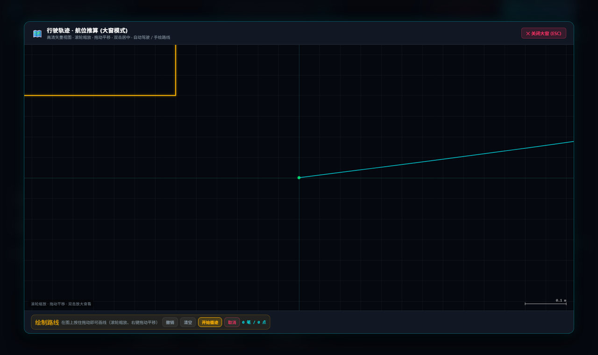
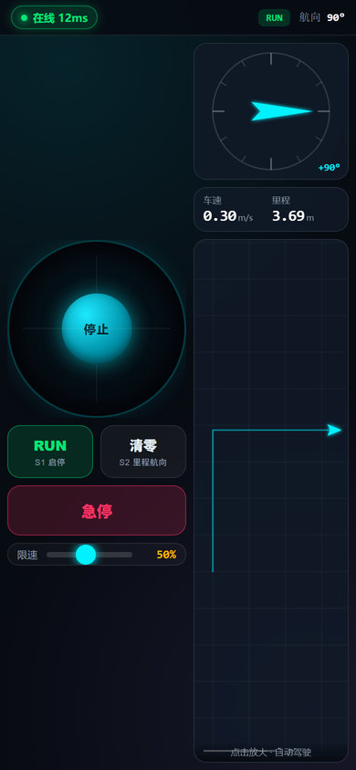
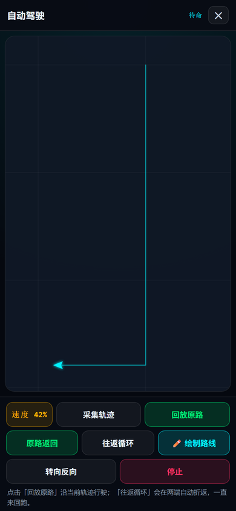
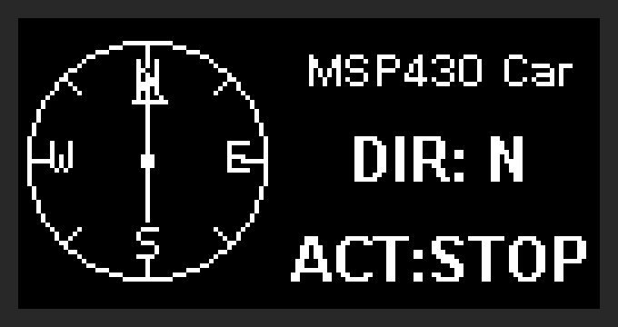
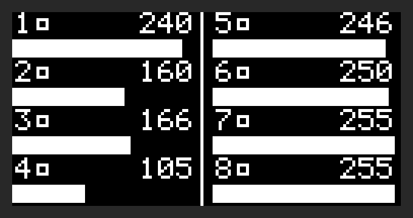

# MSP430 & MSPM0 无线双模遥控小车 (多模态测控与自主导航系统)

<div align="center">

[](https://opensource.org/licenses/MIT)
[](https://github.com/VincentttWang/MSP430_WirelessCar)
[](https://www.ti.com/)
[](http://localhost:8080)
[](https://github.com/VincentttWang/MSP430_WirelessCar)

**基于 TI MSP430F5529 与 MSPM0G3507 双主控芯片的高性能无线遥控、惯导姿态解算与自主导航智能小车系统**

[项目特性](#-核心特性) • [界面预览](#-界面预览) • [系统架构](#-系统分层架构) • [硬件连线](#-硬件连线与引脚定义) • [通信协议](#-双向通信协议与心跳握手机制) • [快速开始](#-快速开始-quick-start) • [文档索引](#-文档索引) • [开源协议](#-开源协议)

</div>

---

## 🚀 核心特性

- **双主控分层协同架构**：
  - **人机交互主机 (Master)**：TI MSP430F5529 LaunchPad，板载 DOGS102x6 点阵液晶屏、ADC 调速旋钮、按键矩阵与双路硬件 UART，支持双向遥测显示与无线透传控制。
  - **底盘运动执行器 (Slave)**：TI MSPM0G3507 (天猛星 v5 拓展板)，集成 TB6612FNG 电机驱动、双轮霍尔编码器、JY61P 六轴高精度陀螺仪、0.96 寸车载 OLED 指南针仪表盘与灰度循线传感器。
- **50Hz 直行航向锁定与差速闭环**：
  - 针对差速底盘动力不均问题，设计了基于 JY61P 航向角的 50Hz 闭环 PID 算法，配合 $\pm 0.5^\circ$ 航向微震动滤波死区，彻底消除起步甩头与直行跑偏。
  - 动力限速全面支持 **5% ~ 100%** 全范围线性调速，原地旋转与行进转弯差速自动按比例平滑自适应，告别生硬急转。
- **HTML5 现代网页测控工作站 (Web Ground Station)**：
  - 支持 **Web Serial 浏览器原生直连** 与 **Python WebSocket 本地桥接服务**。
  - **电脑端单屏 3 栏黄金布局**：左侧 360° 动态惯导罗盘与遥控通信日志，中部 WASD 全向操纵台与 5 档（5%、25%、50%、75%、100%）晶透发光芯片，右侧上半部航位推算轨迹地图与下半部 20Hz 实时双曲线波形示波器。
  - **手机端手柄布局**（`mobile.html`）：横屏左侧居中虚拟摇杆 + 小型 RUN/清零 与串口/小车状态框 + 加长限速滑条；右侧两栏，上行车速里程 + 与电脑端同款旋转罗盘，下行整宽行驶轨迹；点击轨迹图进入全屏自动驾驶面板。急停改为长按 RUN 650ms（松摇杆自动停车）。同一 Wi-Fi 下手机浏览器直接访问，无需装 App。
  - **自主导航**：`采集轨迹` / `回放原路` / `原路返回` / `往返循环` / `✏️ 绘制路线` 五种玩法，配合轨迹 CSV/PNG 导出。绘制模式支持滚轮缩放（以光标为锚点）、右键/中键/Shift 拖动平移、双击或「自适应」一次性取景；已画的线随地图缩放，正在画的一笔始终黏在鼠标下。跑完后橙色虚线参考线自动清除，也可用「🧹 清除参考线」/「清空」随时移除。
- **循线与标定闭环**：
  - 感为 **八路灰度模块（I2C 0x4C）** 与 JY61P **共用 I2C0 总线**，数字量 + 8 路模拟量双读，模块内比较器阈值可现场标定并固化。
  - 巡线校准向导：`白底 → 黑线` 两拍采样，按官方回差公式算阈值写入模块；OLED 全程汉字提示，失败可原地重试。
- **三端实时数据同步**：
  - 车载 OLED 屏、MSP430 手持液晶屏、PC/手机 Web 网页端全链路同步更新车速、里程、动态净加速度 $A_{net}$、航向角及工况状态。
  - 车载 OLED 支持三页切换：**指南针仪表盘** ↔ **八路灰度实时监视**（天猛星 `UP` 键），以及校准向导自动接管。

---

## 🖼️ 界面预览

**电脑端 · 绘制路线**（大窗模式下手绘路径；滚轮缩放、右键拖动平移，松手后按 60mm 重采样循迹）



| 手机端 · 手柄操控 | 手机端 · 全屏自动驾驶 |
| :---: | :---: |
|  |  |

| 车载 OLED · 指南针仪表盘 | 车载 OLED · 八路灰度监视（`UP` 键） | 车载 OLED · 校准向导 |
| :---: | :---: | :---: |
|  |  |  |

> 手机端截图来自无头浏览器在 390×844 视口下的真实渲染（数据由本地模拟遥测服务提供）；
> OLED 三张是**直接从 MCU 显存 `s_oled_fb` 读出的帧**，与屏幕实际显示逐像素一致。

---

## 📐 系统分层架构

工程严格按照模块化、解耦规范组织代码：

```text
MSP430_WirelessCar/
├── 📁 firmware_MSP430F5529/          [主机遥控器固件] TI MSP-EXP430F5529LP 主机工程
│   ├── main.c                        └── 双串口转发、ADC 旋钮采样、DOGS102x6 LCD 高速渲染、按键消抖
│   ├── HAL_Dogs102x6.c / .h          └── 液晶硬件驱动与字符/图标点阵绘制
│   ├── HAL_UCS.c / HAL_PMM.c         └── 时钟系统 (25MHz MCLK) 与电源管理
│   └── MSP430_Car_Master.hex / .out  └── 预编译固件输出
├── 📁 NUEDC_2026/                    [底盘运动固件] 天猛星 MSPM0G3507 v5 底盘工程
│   └── 📁 [Demo] MSPM0_Car_v5/
│       ├── app/                      └── 遥控主任务 (app_remote_car_task.c)、设备自检、巡线闭环
│       ├── core/pid/                 └── 位置式/增量式通用 PID 控制器 (pid.c)
│       ├── bsp/                      └── TB6612 电机、霍尔编码器、JY61P 陀螺仪、OLED、三色指示灯
│       ├── board/                    └── SysConfig 引脚与外设配置 (ti_msp_dl_config.c)
│       └── project/keil/             └── Keil MDK-ARM 工程文件 (NUEDC2025_MSPM0G3507.uvprojx)
├── 📁 tools_pc_remote/               [PC/手机网页测控工作站]
│   ├── index.html                    └── 🚀 现代化单屏 HTML5 测控工作站 (Web Serial 直连)
│   ├── mobile.html                   └── 📱 手机端专用虚拟触控手柄 (局域网直连)
│   ├── web_server.py                 └── 🌐 本地轻量级 HTTP 服务与串口转发桥接器
│   ├── car_remote_gui.py             └── Python 桌面 GUI 控制端
│   └── requirements.txt              └── 依赖库 (pyserial>=3.5)
├── 📁 docs/                          [项目文档与硬件参考]
│   ├── hardware/                     └── 天猛星拓展板 v5 原理图、MSP430F5529 引脚定义表
│   ├── troubleshooting.md            └── 🧭 调试与排障手册（I2C / OLED / 遥测 / 网页）
│   └── images/                       └── 界面预览、运行演示截图
├── 🛠️ 一键编译全部固件.bat            [自动化构建] 顺序调用 CCS cl430 与 Keil 编译两套固件
├── 🛠️ 一键编译天猛星.bat              [自动化构建] 仅编译 MSPM0G3507 底盘固件
├── 🛠️ 一键编译MSP430.bat             [自动化构建] 仅编译 MSP430F5529 遥控器固件
├── ⚡ 一键烧录全部固件.bat            [自动化烧录] 调用 TI DSLite 与 Keil 烧录工具链
├── 🚀 启动小车网页测控工作站.bat      [一键启动] 唤起浏览器打开 HTML5 网页测控工作站
├── LICENSE                           [开源许可] MIT License
└── README.md                         [项目说明] 本文档
```

---

## 🔌 硬件连线与引脚定义

### 1. MSP430 与天猛星双机串口互联（3 根杜邦线）
| 天猛星 MSPM0G3507 (CN7 接口) | MSP430F5529 (J4 排针) | 信号功能说明 |
| :--- | :--- | :--- |
| **Pin 3: PA24 (UART2_RX)** | **J4.5: P4.4 (UCA1TXD)** | MSP430 向天猛星下发按键、调速与心跳指令 |
| **Pin 4: PB15 (UART2_TX)** | **J4.3: P4.5 (UCA1RXD)** | 天猛星向 MSP430 回传 20 字节高频车载遥测数据 |
| **Pin 2: GND** | **J4.13: GND** | **两板必须共地 (Common Ground)** |

> [!NOTE]
> 天猛星 v5 拓展板上 `PB15` 已配置为原生 `IOMUX_PINCM32_PF_UART2_TX`，彻底避免了原引脚与步进电机、绿灯的冲突，下行遥测数据流畅稳定。

### 2. 天猛星底盘外设与传感器引脚
| 模块名称 | 天猛星引脚 / 接口 | 功能说明 |
| :--- | :--- | :--- |
| **三色指示灯 (H2)** | **PB16 (红), PB27 (黄), PA23 (绿)** | 未连接亮红灯；连接待命亮黄灯；运行/循线亮绿灯 |
| **六轴陀螺仪 (JY61P)** | **PA0 (I2C0_SDA), PA1 (I2C0_SCL)** | 硬件 I2C0 轮询解算；已做底部倒装坐标系极性归一化 |
| **左电机驱动 (TB6612)** | PA7 (PWM), PA16/PB17 (AIN1/2) | 定时器 PWM 调速与差速转向 |
| **右电机驱动 (TB6612)** | PB10 (PWM), PB18/PB19 (BIN1/2) | 定时器 PWM 调速与差速转向 |
| **双轮霍尔编码器** | PA22/25 (左轮), PA28/2 (右轮) | 外部中断计数，推算实时线速度与行驶里程 |
| **车载 0.96 OLED (U1)** | PA10 (I2C1_SDA), PA11 (I2C1_SCL) | 指南针仪表盘 / 八路灰度监视 / 校准向导三页，地址 `0x3C` |
| **感为八路灰度** | I2C0 总线（与 JY61P 共用），地址 `0x4C` | 数字量位图 + 8 路模拟量 + 阈值标定；4.5~5V 供电，需共地 |
| **按键 (UP / DOWN)** | **PA14 (UP), PB25 (DOWN)** | UP 切换 OLED 页面；DOWN 进入循线校准向导 |

---

## 📡 双向通信协议与心跳握手机制

### 1. 天猛星 $\to$ MSP430 / PC 遥测数据帧（20 字节，20Hz）
```text
[0xAA] [0x55] [SPD_PCT] [STATE] [LIGHT] [SPD_H] [SPD_L] [DIST_3] [DIST_2] [DIST_1] [DIST_0] [YAW_H] [YAW_L] [ACC_H] [ACC_L] [DUTY_L] [DUTY_R] [CHKSUM] [0x55] [0xAA]
```
- `SPD_PCT` (uint8_t): 当前动力限速百分比（5% ~ 100%）。
- `STATE` (uint8_t): 运行工况（0=STOP, 1=RUN, 2=TRACK, 3=BRAKE）。
- `LIGHT` (uint8_t): 状态指示（0=红灯, 1=绿灯）。
- `SPD` (int16_t): 实时线速度（单位 $mm/s$）。
- `DIST` (int32_t): 累计行驶里程（单位 $mm$）。
- `YAW` (int16_t): 航向偏航角（单位 $0.1^\circ$，范围归一化至 $-180.0^\circ \sim +180.0^\circ$）。
- `ACC` (int16_t): 动态净加速度模长 $A_{net} = |A_{tot} - g_{ref}|$（单位 $0.01g$，静止自动归零）。
- `CHKSUM` (uint8_t): 从 `SPD_PCT` 到 `DUTY_R` 数据的累加和低 8 位。

### 2. 控制指令协议
- **方向与运动掩码**：`!DIR:<mask\>#`（支持前后与左右按键多键并发，平滑叠加生成斜向圆弧轨迹）。
- **动力限速设定**：`!SPD:<pct\>#`（范围 5 ~ 100）。
- **运行模式切换**：`!RUN#` / `!STOP#` / `!MODE:TRACK#` / `!MODE:MANUAL#`。
- **航向里程归零**：`!RST#`。
- **双端心跳维持**：每 200ms 下发 `'h'`，800ms 内未收到心跳触发看门狗自动安全刹车。

### 3. 巡线校准指令（`!CAL:*`）

由网页端「循线校准」弹窗或天猛星 `DOWN` 键触发，OLED 同步显示向导：

| 指令 | 作用 |
| :--- | :--- |
| `!CAL:START#` | 进入向导（挂起 JY61P 轮询，把 I2C0 让给灰度），回 `!CAL:WAIT_WHITE#` |
| `!CAL:W#` | 采集白底 8 次平均，成功回 `!CAL:W_OK,<8 路白基准>#` 并提示放到黑线上 |
| `!CAL:B#` | 采集黑线并写入阈值，回 `!CAL:DONE,<8 路阈值>#`；失败回 `!CAL:ERR_I2C#` |
| `!CAL:REQ#` | 轮询当前 8 路数字位图 + 在线标志 + 地址 + 8 路模拟量 `!CAL:PROBES,...#` |
| `!CAL:EXIT#` | 退出向导、恢复陀螺仪轮询、OLED 回到仪表盘 |

> [!NOTE]
> `PROBES` 帧格式：`!CAL:PROBES,<mask hex>,<online>,<addr hex>,<a0..a7>#`。
> `online=0` 表示总线上没应答——先量模块 VCC 与共地，而不是改代码。

---

## 💻 快速开始 (Quick Start)

### 1. 固件一键编译
项目已配置便携批处理编译链：
- **编译全部固件**：直接双击运行根目录下的 **`🛠️ 一键编译全部固件.bat`**。
- **独立编译**：
  - 双击 **`🛠️ 一键编译天猛星.bat`**（使用 Keil ARMCLANG 编译 MSPM0G3507 固件，0 Error 0 Warning）。
  - 双击 **`🛠️ 一键编译MSP430.bat`**（使用 TI CCS cl430 编译 MSP430F5529 固件，Build Succeeded）。

### 2. 固件烧录
- 连接 MSP430F5529 与 MSPM0G3507 调试器 USB 线至电脑。
- 双击运行 **`⚡ 一键烧录全部固件.bat`**（或分别运行 `一键烧录MSP430固件.bat` 与 `一键烧录天猛星固件.bat`）。

### 3. 启动上位机测控平台
- 双击运行根目录下的 **`🚀 启动小车网页测控工作站.bat`**。
- 浏览器将自动打开 `http://localhost:8080/index.html`。
- 点击右上角 **`⚡ 连接串口 (Web Serial)`**，选择小车无线串口对应的 COM 口，波特率 `115200`，即可实现毫秒级超低延迟遥控与实时遥测波形监测！

### 4. 手机端手柄操控
- 手机与电脑连**同一个 Wi-Fi**，启动脚本会打印本机局域网地址。
- 手机浏览器打开 `http://<电脑IP>:8080/mobile.html`：
  - **横屏左侧**：居中虚拟摇杆，底部一排小号 `RUN` / `清零` + 串口连接、小车状态两个小框，最下方是拉长的限速滑条；
  - **横屏右侧**：两栏，上行左边车速/里程、右边与电脑端同款的 360° 旋转罗盘，下行整宽行驶轨迹图，点击轨迹图进入全屏自动驾驶面板；
  - **急停**：短按 `RUN` 仍是启停切换，**长按 650ms** 为急停；松开摇杆本身就会发 `!DIR:0#` 停车，自动驾驶面板里也保留「停止」。
- 可加到主屏幕当 App 用：`#auto` 直接进自动驾驶面板，`#draw` 直接进绘制路线。

### 5. 车载按键

| 按键 | 短按 |
| :--- | :--- |
| `UP` (PA14) | 指南针仪表盘 ⇄ 八路灰度实时监视（校准向导运行时让位） |
| `DOWN` (PB25) | 进入 / 推进巡线校准向导（白底 → 黑线 → 写入阈值） |

---

## 📚 文档索引

| 文档 | 内容 |
| :--- | :--- |
| [`docs/troubleshooting.md`](docs/troubleshooting.md) | 🧭 **调试与排障手册**：I2C 状态寄存器判读、OLED 显存直读、遥测掉帧定位、网页端自动化 |
| [`NUEDC_2026/[Demo] MSPM0_Car_v5/docs/architecture.md`](NUEDC_2026/%5BDemo%5D%20MSPM0_Car_v5/docs/architecture.md) | 固件分层与模块依赖 |
| [`.../docs/build-guide.md`](NUEDC_2026/%5BDemo%5D%20MSPM0_Car_v5/docs/build-guide.md) | Keil / CCS 编译与烧录细节 |
| [`.../docs/project-structure.md`](NUEDC_2026/%5BDemo%5D%20MSPM0_Car_v5/docs/project-structure.md) | 目录结构与命名约定 |
| [`.../docs/interfaces/`](NUEDC_2026/%5BDemo%5D%20MSPM0_Car_v5/docs/interfaces) | 每个 app/core/bsp/middleware 模块的接口说明 |
| [`.../docs/interfaces/bsp_grayscale_sensor.md`](NUEDC_2026/%5BDemo%5D%20MSPM0_Car_v5/docs/interfaces/bsp_grayscale_sensor.md) | 感为八路：寄存器表、重复起始时序、9 字节 FIFO 坑 |
| [`.../docs/interfaces/bsp_oled.md`](NUEDC_2026/%5BDemo%5D%20MSPM0_Car_v5/docs/interfaces/bsp_oled.md) | OLED 三页 UI、汉字字库生成、掉屏自愈 |
| [`.../docs/interfaces/bsp_key.md`](NUEDC_2026/%5BDemo%5D%20MSPM0_Car_v5/docs/interfaces/bsp_key.md) | 按键消抖状态机与 UP/DOWN 引脚 |
| [`.../docs/changelog.md`](NUEDC_2026/%5BDemo%5D%20MSPM0_Car_v5/docs/changelog.md) | 逐条变更记录 |

---

## 📄 开源协议

本项目采用 [MIT License](LICENSE) 开源许可协议，欢迎自由学习、改进、复用与贡献代码。

Copyright (c) 2026 Vincent Wang ([@VincentttWang](https://github.com/VincentttWang))
